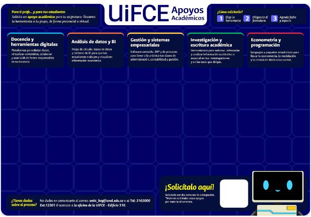
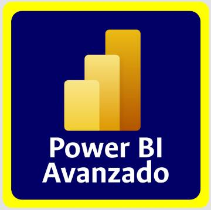
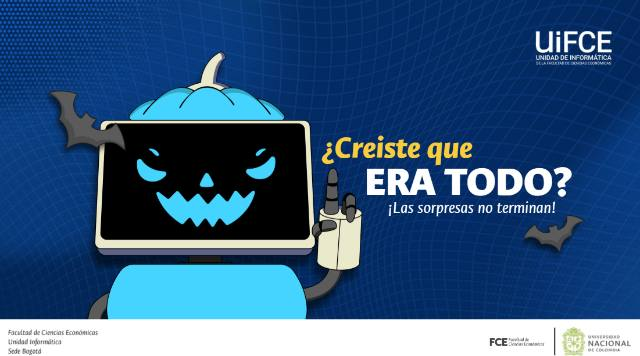
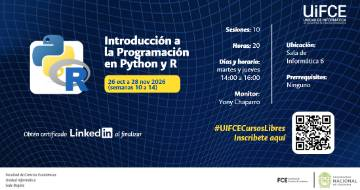
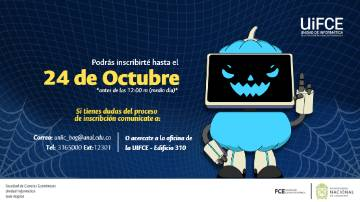

# Reunión de dirección 2 · Información y material de contexto

Material de apoyo para la presentación de Estrategias Tecnológicas (ET) en la **Reunión de dirección 2**.
Salió del tablero «Reunión coordinación» de la plataforma interna *Oficina de Gestión de Proyectos (PMO) de Estrategias Tecnológicas "ET en Marcha"*.

| Dato | Valor |
|---|---|
| Reunión | Reunión de dirección 2 |
| Fecha y hora | 30 de octubre de 2026, 8:00 a. m. (hora de Colombia) |
| Tipo | Dirección |
| Presenta | Máster de Estrategias Tecnológicas |
| Estado de los datos | **13 de noviembre de 2026** (no el día de la reunión; ver [observaciones](#observaciones-sobre-los-datos)) |

## 1. Contexto

- **ET** es una de las siete áreas de la UIFCE (Apoyos Académicos, Gestión del Conocimiento, Estrategias Tecnológicas, Desarrollo, Virtualización, Cursos Libres y Coordinación). Se encarga de redes sociales, difusión, piezas gráficas y audiovisuales, micrositio, microtalleres y eventos de la Unidad.
- Principio rector del semestre 2026-2: **calidad sobre cantidad**.
- La presentación se organiza en cinco páginas (ver [`../../README.md`](../../README.md)): general, lo que entregamos, en curso y bloqueos, próximo corte, y notas y comentarios.
- Desde octubre, los proyectos se clasifican en 4 líneas de trabajo y 15 categorías con una regla: *¿con quién se hace?* Lo que se hace con otra dependencia es «Articulación con [dependencia]»; lo demás, por lo que entrega. Las categorías de abajo son las vigentes.

## 2. Lo que entregamos

| Proyecto | Categoría | Estado | Subtareas |
|---|---|---|---|
| Elaboración de piezas gráficas de Cursos Libres — Lanzamiento especial | Articulación con Cursos Libres | Completado | 6 de 6 |
| Cartelera física de Apoyos Académicos (AA) | Articulación con Apoyos Académicos | Completado | 3 de 6 |
| Infografía sobre actualización de reglas de puntualidad en la UIFCE | Articulación con Coordinación | Completado | 5 de 10 |
| Video tutorial para el aplicativo Programación de salones | Producción de contenido | Completado | 0 de 7 |
| Cápsulas de tecnología y difusión de aplicativos en pantallas UIFCE (Noticias UIFCE) | Carteleras y pantallas | Completado | 0 de 7 |
| Feria de Servicios e Innovación Tecnológica UIFCE | Eventos y formación | Completado | 2 de 3 |
| Red Ejecutiva ET: alianzas estratégicas y proyectos con empresas líderes | Alianzas y comunidad | En curso | 0 de 7 |

## 3. En curso

| Proyecto | Categoría | Estado | Subtareas |
|---|---|---|---|
| Tracker de egresados UIFCE: trayectoria laboral y conexión con antiguos monitores | Alianzas y comunidad | En curso | 4 de 6 |
| Microtalleres UIFCE | Eventos y formación | En curso | 2 de 7 |
| Red Ejecutiva ET: alianzas estratégicas y proyectos con empresas líderes | Alianzas y comunidad | En curso | 0 de 7 |
| Blog UIFCE | Canales digitales | Por iniciar | 0 de 2 |

## 4. Bloqueos

- Pausas operativas recurrentes causadas por el agotamiento de tokens de Claude Code.

## 5. En el próximo corte

| Proyecto | Categoría | Estado | Subtareas |
|---|---|---|---|
| Campaña de difusión del aplicativo «Programación de Salones» | Producción de contenido | En curso | 1 de 6 |
| Cartelera física de Apoyos Académicos (AA) | Articulación con Apoyos Académicos | Completado | 3 de 6 |

## 6. Notas y comentarios

- Priorización del Excel (planeación inicial).
- **Microtalleres asignados:** QuickBooks (2 sesiones); proyecto de estudio (1 sesión); análisis de datos financieros con IA (1 sesión); 1 sesión por confirmar.
- **ET · Desarrollo:** rediseño y despliegue de las tarjetas del micrositio; revisar el filtro y el formato antiguo en WordPress (Proyectos de estudio).
- **Concurso/Hackatón:** a la espera de la reunión con el director para acordar la fecha final.

## 7. Antecedente: reunión guardada el 23 de octubre («Reunión coordinación 3»)

La plataforma conserva la presentación anterior tal como se vio ese día:

- **Entregado:** 6 proyectos (lanzamiento especial de Cursos Libres, cartelera física de Apoyos Académicos, Red Ejecutiva ET, infografía de puntualidad, video tutorial de Programación de salones y cápsulas de Noticias UIFCE).
- **Próximo corte:** Campaña de difusión del aplicativo «Programación de Salones» y Tracker de egresados UIFCE.
- **Bloqueo:** daño en el televisor entre salas (no lee las memorias).

## 8. Material visual

Piezas gráficas enlazadas a los proyectos de esta presentación. Son piezas institucionales de difusión.

| Imagen | Proyecto | Qué muestra |
|---|---|---|
|  | Cartelera física de Apoyos Académicos (AA) | Cartelera con las cinco líneas de apoyo y los tres pasos para solicitarlos (60 × 100). |
|  | Cartelera física de Apoyos Académicos (AA) | Ficha de un apoyo (Power BI Avanzado) para la cartelera. |
|  | Lanzamiento especial de Cursos Libres | Pieza principal, enfoque Halloween: «¿Creíste que era todo?» |
|  | Lanzamiento especial de Cursos Libres | Pieza «¡Lanzamiento especial!». |
|  | Lanzamiento especial de Cursos Libres | Ficha del curso Introducción a la Programación en Python y R (26 oct al 28 nov de 2026). |
|  | Lanzamiento especial de Cursos Libres | Cierre de inscripciones: 24 de octubre. |

## Observaciones sobre los datos

Conviene revisarlas antes de presentar:

1. **Fecha de corte.** Los estados son los del 13 de noviembre. Para ver cómo estaba el 30 de octubre, la única fotografía guardada es la del 23 de octubre (sección 7).
2. **Proyectos en dos secciones.** *Red Ejecutiva ET* aparece en «Lo que entregamos» y en «En curso»; la *Cartelera física de Apoyos Académicos* aparece en «Lo que entregamos» y en «Próximo corte».
3. **Estado y subtareas no coinciden.** El video tutorial y las cápsulas figuran como completados con 0 de 7 subtareas hechas; la infografía, con 5 de 10; la cartelera, con 3 de 6. *Red Ejecutiva ET* está en «Lo que entregamos» con 0 de 7 y estado «En curso».
4. **Nombre unificado.** «Concurso/Hackatón» es el nombre vigente (antes «Hackatón»).

## Qué no se incluyó y por qué

Este repositorio es público, así que se dejó fuera:

- Nombres de las personas del equipo y quién tiene cada proyecto, y las fotos del equipo de la portada.
- Un bloqueo registrado en la reunión guardada que se refiere a la dinámica interna del equipo.
- La infografía de reglas de puntualidad: describe sanciones internas para personal y monitores. Solo se menciona su título.
- Los enlaces de edición de las piezas (Canva y Drive).
